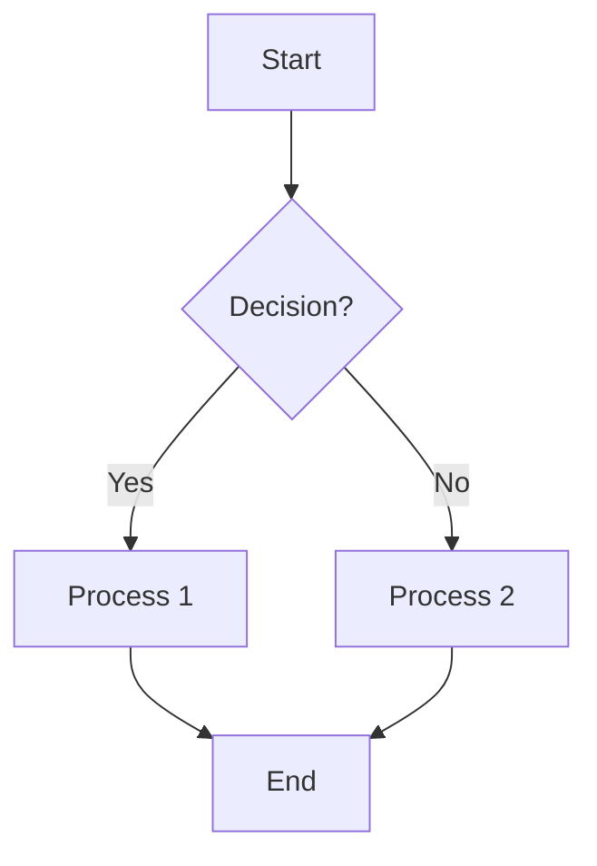

# Visual Elements Specification

This document defines the standards, formats, and requirements for all visual elements used in the Luxembourg SME Accounting Textbook, following OpenStax quality standards.

## Overview

Visual elements are essential for effective accounting education. They help students understand abstract concepts, see relationships between accounts, and visualize processes. This specification ensures consistency, accessibility, and educational effectiveness across all chapters.

## Visual Element Types

### 1. T-Accounts

**Purpose:** Visual representation of ledger accounts showing debits and credits.

**Standards:**
- Must clearly show account title
- Left side (debit) and right side (credit) clearly labeled
- Entries should be numbered or dated for reference
- Final balance clearly indicated
- Must include PCN account number when applicable

**Formats:**
- **ASCII Art** (for markdown source): Simple text-based representation
- **HTML/CSS** (for web version): Styled with borders and proper alignment
- **SVG** (for high-quality rendering): Scalable vector graphics for print

**Minimum Requirements:**
- Account title at top
- Debit (DR) and Credit (CR) labels
- Horizontal line separating title from entries
- Vertical line separating debit from credit
- Balance calculation shown

**Example Structure:**
```
Account Title (PCN Code)
─────────────────────────
Debit (DR)    │    Credit (CR)
──────────────┼──────────────
Entry 1       │    Entry 2
Entry 3       │    Entry 4
──────────────┼──────────────
Balance       │    Balance
```

**Accessibility:**
- Alt text must describe the account, entries, and final balance
- For screen readers: "T-account for [Account Name], showing [X] debit entries totaling [amount] and [Y] credit entries totaling [amount], with a final balance of [amount]"

### 2. Flowcharts

**Purpose:** Show processes, decision trees, and workflows (e.g., accounting cycle, transaction analysis).

**Standards:**
- Clear start and end points
- Decision points clearly marked (diamonds)
- Process steps in rectangles
- Flow direction indicated with arrows
- Luxembourg-specific steps highlighted

**Formats:**
- **Mermaid** (for markdown): Text-based diagram syntax
- **SVG** (for high-quality): Vector graphics
- **HTML/CSS** (for web): Interactive elements possible

**Minimum Requirements:**
- Title/description
- Clear flow direction
- All decision points have yes/no paths
- All process steps labeled
- Luxembourg compliance steps identified

**Accessibility:**
- Alt text describes the process flow
- Text-based description of the flowchart logic
- For complex flowcharts, provide step-by-step narrative

### 3. Financial Statement Examples

**Purpose:** Show complete, formatted financial statements with Luxembourg PCN structure.

**Standards:**
- Use proper PCN account classifications
- Show all required sections
- Include proper formatting (euros, alignment)
- Show relationships between statements
- Include notes where relevant

**Formats:**
- **Markdown Tables** (for source)
- **HTML Tables** (for web, with styling)
- **PDF Format** (for print, professional appearance)

**Minimum Requirements:**
- Account names in French and English
- PCN account codes
- Proper euro formatting (€X,XXX.XX)
- Totals clearly indicated
- Section subtotals shown

**Accessibility:**
- Table headers properly marked
- Summary description of statement contents
- Key figures highlighted in text

### 4. Process Diagrams

**Purpose:** Illustrate multi-step processes (e.g., journal entry to financial statements, VAT calculation).

**Standards:**
- Sequential steps clearly numbered
- Inputs and outputs identified
- Luxembourg-specific steps highlighted
- Visual flow from start to finish

**Formats:**
- **Mermaid sequence diagrams** (for markdown)
- **SVG** (for high-quality)
- **HTML/CSS** (for web, with animations possible)

**Accessibility:**
- Step-by-step text description
- Alt text for the overall process
- Clear labels for all elements

### 5. Comparison Tables

**Purpose:** Compare concepts, methods, or options (e.g., perpetual vs. periodic inventory, cash vs. accrual).

**Standards:**
- Clear column headers
- Consistent row structure
- Key differences highlighted
- Luxembourg context included

**Formats:**
- **Markdown Tables** (for source)
- **HTML Tables** (for web)
- **PDF Tables** (for print)

**Minimum Requirements:**
- Clear comparison criteria
- Side-by-side comparison
- Luxembourg-specific considerations column
- Summary row highlighting key differences

**Accessibility:**
- Proper table headers
- Summary of key differences in text
- Screen reader friendly structure

### 6. Calculation Examples

**Purpose:** Show step-by-step calculations with clear formatting.

**Standards:**
- Show all steps
- Clear labels for each step
- Proper euro formatting
- Final answer highlighted
- Show formulas where relevant

**Formats:**
- **Markdown** (with proper formatting)
- **HTML** (with math rendering if needed)
- **LaTeX** (for complex formulas in PDF)

**Minimum Requirements:**
- Formula shown
- Step-by-step calculation
- Units clearly indicated (€)
- Final answer boxed or highlighted

**Accessibility:**
- Text description of calculation steps
- Formula in accessible format
- Result clearly stated

## Visual Element Density Requirements

### Per Chapter Section
- **Minimum:** 3-5 visual elements per major section
- **Target:** 5-7 visual elements per major section
- **Maximum:** Based on educational need (no arbitrary limit)

### Visual Element Distribution
- At least one T-account example per section covering transactions
- At least one flowchart for process-oriented sections
- Financial statement examples when relevant
- Comparison tables for contrasting concepts
- Calculation examples for computational sections

## Placement Guidelines

### Within Text
- Visual elements should appear immediately after the concept is introduced
- Place before complex explanations when the visual aids understanding
- Place after explanations when the visual reinforces understanding
- Never place visuals in isolation—always with explanatory text

### Spacing
- One blank line before visual element
- One blank line after visual element
- Visual element should not break across pages (in print)

### Captions
- All visual elements must have captions
- Format: "**Figure X.Y:** [Description]"
- Caption should explain what the visual shows, not just label it
- Include Luxembourg-specific context in caption when relevant

## Format Specifications

### T-Account Format

**ASCII Art (Markdown):**
```markdown
**Cash (510000)**
─────────────────────────
Debit (DR)    │    Credit (CR)
──────────────┼──────────────
1,000.00      │    500.00
2,000.00      │    300.00
──────────────┼──────────────
3,000.00      │    800.00
──────────────┼──────────────
Balance: 2,200.00 (Debit)
```

**HTML/CSS (Web):**
- Use `<table>` with proper styling
- Borders and alignment
- Responsive design
- Print-friendly styles

**SVG (Print/High Quality):**
- Vector graphics
- Professional appearance
- Scalable without quality loss

### Flowchart Format

**Mermaid (Markdown):**


**Accessibility:**
- Text description of flowchart logic
- Step-by-step narrative

### Table Format

**Markdown:**
```markdown
| Concept | Method A | Method B | Luxembourg Context |
|---------|----------|----------|---------------------|
| Feature 1 | Value | Value | PCN requirement |
```

**Accessibility:**
- Proper header rows
- Summary text describing table contents

## Accessibility Requirements

### WCAG 2.1 AA Compliance

**Alt Text:**
- All visual elements must have descriptive alt text
- Alt text should describe content, not just label it
- Include key information (amounts, relationships) in alt text
- Maximum 125 characters for simple visuals, longer descriptions for complex visuals

**Color Contrast:**
- Text in visuals must meet WCAG AA standards (4.5:1 for normal text, 3:1 for large text)
- Color should not be the only means of conveying information
- Use patterns, labels, or text in addition to color

**Screen Reader Support:**
- All visual elements must be described in text
- Complex visuals need detailed text descriptions
- Tables must have proper headers
- Flowcharts need step-by-step text descriptions

**Structure:**
- Proper heading hierarchy
- Descriptive link text (for interactive elements)
- Logical reading order

## Luxembourg-Specific Requirements

### PCN Integration
- All T-accounts must include PCN account codes
- Financial statements must follow PCN structure
- Account names in French with English translations

### VAT Representation
- VAT calculations must show Luxembourg rates (3%, 8%, 14%, 17%)
- VAT flow diagrams must show eCDF filing process
- VAT tables must reference Luxembourg regulations

### Compliance Visualization
- Process diagrams must include compliance steps (eCDF, RCS filing)
- Timeline diagrams for filing deadlines
- Decision trees for regulatory requirements

## Quality Checklist

Before including a visual element, verify:

- [ ] Visual supports learning objectives
- [ ] Visual is clear and easy to understand
- [ ] Visual includes Luxembourg context where relevant
- [ ] Alt text is descriptive and informative
- [ ] Caption explains the visual's purpose
- [ ] Visual is properly formatted
- [ ] Visual follows placement guidelines
- [ ] Visual is accessible (WCAG 2.1 AA)
- [ ] Visual is consistent with other visuals in the chapter
- [ ] Visual adds educational value (not decorative)

## Template Library Location

Templates for all visual element types are stored in:
- `templates/visual_elements/`

See individual template files for specific formats and examples.

## Version Control

- Visual element specifications version: 1.0
- Last updated: [Current Date]
- Next review: Quarterly

## References

- OpenStax Principles of Accounting visual standards
- WCAG 2.1 AA Guidelines
- Luxembourg PCN 2020 Chart of Accounts
- Luxembourg eCDF and RCS requirements

