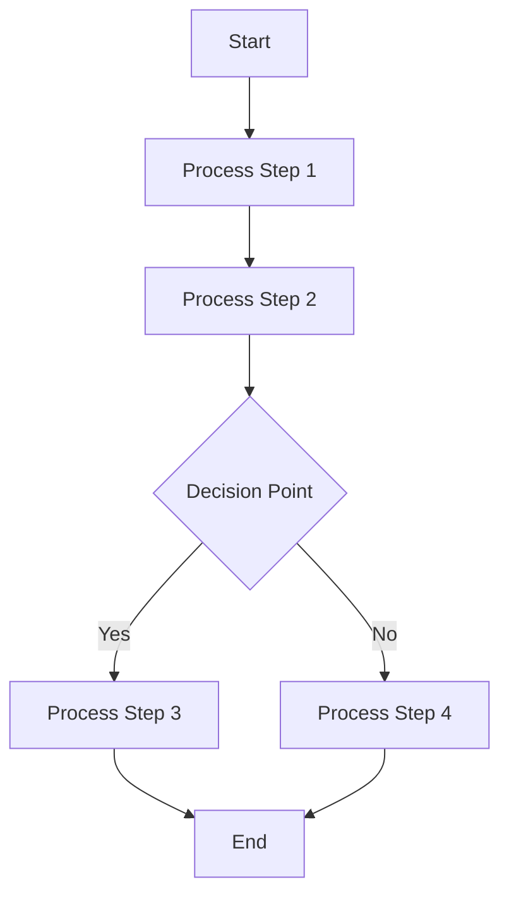
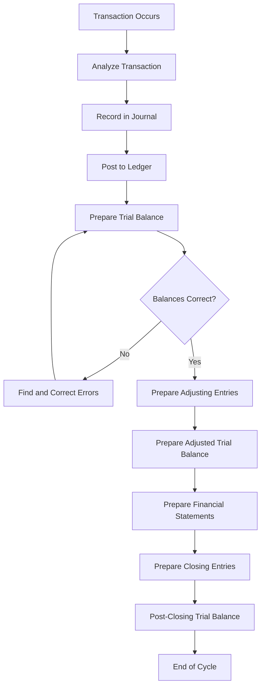
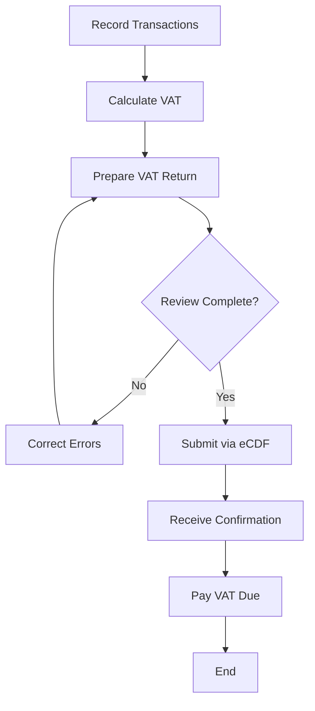

# Flowchart Template

## Mermaid Format (Markdown)

Mermaid is a text-based diagram syntax that renders as flowcharts. It's supported by many markdown renderers.

### Basic Process Flowchart

```markdown

```

### Accounting Cycle Flowchart

```markdown

```

### Luxembourg-Specific Process (VAT Filing)

```markdown

```

## Text Description Format (Accessibility)

For each flowchart, provide a text description:

```markdown
**Process Description:**

The accounting cycle begins when a transaction occurs. The transaction is analyzed to determine which accounts are affected. The transaction is then recorded in the journal using double-entry bookkeeping. Next, the journal entries are posted to the appropriate ledger accounts. A trial balance is prepared to verify that debits equal credits. If the trial balance doesn't balance, errors must be found and corrected. Once the trial balance is correct, adjusting entries are prepared and posted. An adjusted trial balance is prepared, followed by the financial statements. Finally, closing entries are made to reset temporary accounts, and a post-closing trial balance is prepared to verify the closing process.
```

## HTML/CSS Format (Web with Styling)

For more control over appearance, use HTML/CSS:

```html
<div class="flowchart">
  <div class="flowchart-step start">Start</div>
  <div class="flowchart-arrow">↓</div>
  <div class="flowchart-step process">Process Step 1</div>
  <div class="flowchart-arrow">↓</div>
  <div class="flowchart-step decision">Decision Point?</div>
  <div class="flowchart-branch">
    <div class="flowchart-arrow yes">Yes →</div>
    <div class="flowchart-step process">Process Step 2</div>
  </div>
  <div class="flowchart-branch">
    <div class="flowchart-arrow no">No →</div>
    <div class="flowchart-step process">Process Step 3</div>
  </div>
  <div class="flowchart-arrow">↓</div>
  <div class="flowchart-step end">End</div>
</div>
```

## Accessibility Requirements

- **Alt Text:** Describe the overall process flow
- **Text Description:** Provide step-by-step narrative
- **Screen Reader:** Ensure logical reading order
- **Color:** Don't rely solely on color to convey information

## Usage Guidelines

1. Use flowcharts for processes with multiple steps
2. Clearly mark start and end points
3. Use decision diamonds for choices
4. Use rectangles for process steps
5. Show flow direction with arrows
6. Highlight Luxembourg-specific steps
7. Keep flowcharts simple—break complex processes into multiple diagrams

## Luxembourg-Specific Elements

- Highlight compliance steps (eCDF, RCS filing)
- Show regulatory decision points
- Include PCN-related steps
- Show VAT calculation and filing process
- Indicate multilingual requirements

