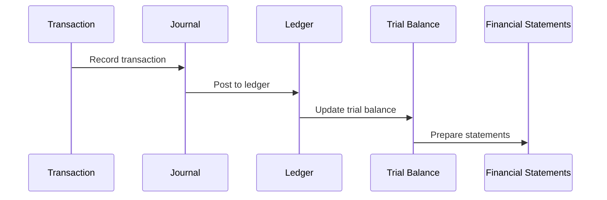
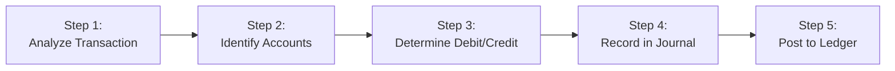

# Process Diagram Template

## Mermaid Sequence Diagram Format

For showing sequential processes with multiple participants or steps:

```markdown

```

## Mermaid Flowchart Format (Process Steps)

For step-by-step processes:

```markdown

```

## Text-Based Process Format

For simple processes or when diagrams aren't supported:

```markdown
**Transaction Recording Process:**

1. **Analyze the Transaction**
   - Identify what happened
   - Determine accounts affected
   
2. **Apply Accounting Equation**
   - Assets = Liabilities + Equity
   - Ensure equation remains balanced
   
3. **Determine Debit and Credit**
   - Identify which accounts increase/decrease
   - Apply normal balance rules
   
4. **Record in Journal**
   - Write journal entry
   - Include date, accounts, amounts, description
   
5. **Post to Ledger**
   - Transfer to T-accounts
   - Update account balances
```

## HTML/CSS Process Steps

For web rendering with styling:

```html
<div class="process-diagram">
  <div class="process-step">
    <div class="step-number">1</div>
    <div class="step-content">
      <h4>Analyze Transaction</h4>
      <p>Identify accounts affected and transaction type</p>
    </div>
  </div>
  <div class="process-arrow">→</div>
  <div class="process-step">
    <div class="step-number">2</div>
    <div class="step-content">
      <h4>Apply Accounting Equation</h4>
      <p>Ensure Assets = Liabilities + Equity</p>
    </div>
  </div>
  <!-- More steps -->
</div>
```

## Luxembourg-Specific Process Examples

### VAT Calculation and Filing Process

```markdown
**VAT Calculation and Filing Process:**

1. **Record Sales and Purchases**
   - Identify VAT rates (3%, 8%, 14%, 17%)
   - Calculate VAT on each transaction
   
2. **Calculate VAT Due**
   - Sum VAT collected on sales
   - Sum VAT paid on purchases
   - Calculate net VAT due
   
3. **Prepare VAT Return**
   - Complete eCDF form
   - Include all required information
   
4. **Submit via eCDF**
   - Log into eCDF portal
   - Upload completed return
   - Receive confirmation
   
5. **Pay VAT Due**
   - Transfer funds by deadline
   - Keep payment confirmation
```

## Accessibility Requirements

- **Alt Text:** Describe the overall process
- **Text Description:** Provide step-by-step narrative
- **Screen Reader:** Ensure logical reading order
- **Numbering:** Use clear step numbers

## Usage Guidelines

1. Use for multi-step processes
2. Number steps clearly
3. Show inputs and outputs
4. Highlight Luxembourg-specific steps
5. Keep diagrams simple—break complex processes into sub-processes
6. Include decision points when relevant

## Common Process Diagrams Needed

- Transaction analysis process
- Journal entry to financial statements flow
- VAT calculation and filing process
- Financial statement preparation process
- Closing entries process
- Adjusting entries process
- PCN account classification process

